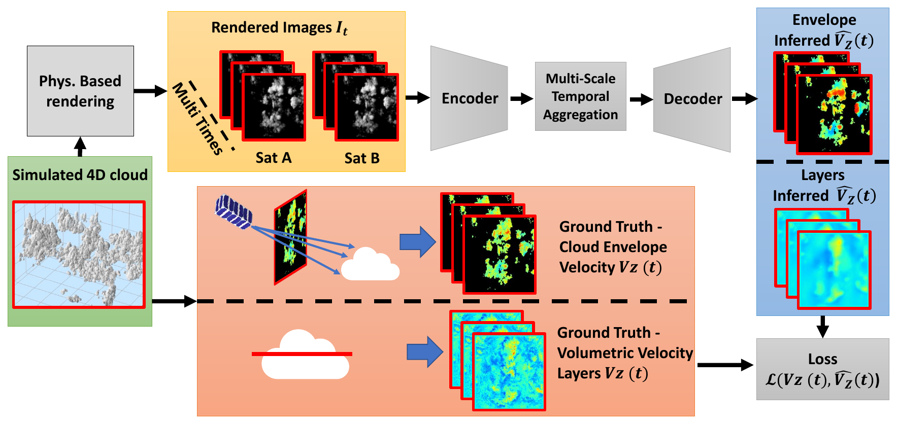

# Inferring Vertical Air Flow by Spaceborne Imaging (WACV 2027)

Dor Danino, Udi Gal, Vadim Holodovsky, Daniel Rosenfeld, Barry Lynn, Céline Cornet, Yoav Y. Schechner

Paper (link TBA) · [Project page](https://dordanino12.github.io/Inferring-Vertical-Air-Flow/) · Data & checkpoints: [Zenodo](https://doi.org/10.5281/zenodo.24102992) · LES fields: [Zenodo](https://doi.org/10.5281/zenodo.24106971)

We infer the vertical air velocity $V_z$, both at the visible cloud envelope and on
horizontal layers inside and around clouds, from sequences of stereo images taken by two
orbiting satellites. A spatiotemporal U-Net (MiT-B1 encoder, ConvLSTM in the bottleneck
and in the skip connections) is trained on physics-based data. That data is made by
path-tracing LES cloud fields (Mitsuba 3) along a realistic orbit.



## Repository layout

```
vertical_airflow/        model, dataset, losses, helpers
train.py                 K-fold training of one experiment (one YAML config)
evaluate.py              K-fold ensemble evaluation (Tables 1-3, Fig. 6)
configs/                 one config per experiment in the paper
figures/                 Fig. 6 scatter, Fig. 7 qualitative panels
data_generation/         LES -> volumes -> Mitsuba renders -> ground-truth maps -> K-fold dataset
real_data/seac4rs/       AirMSPI / DC-8 real-data experiment (Sec. 5, Fig. 11)
assets/                  satellite overpass geometry (2 satellites, 12 times x 20 s)
scripts/                 train / evaluate all experiments
```

## Installation

```bash
python -m venv venv && source venv/bin/activate     # tested with Python 3.8, CUDA 11.8
pip install torch==2.4.1 torchvision==0.19.1 --index-url https://download.pytorch.org/whl/cu118
pip install -r requirements.txt
```
The ImageNet weights of the MiT-B1 / ResNet18 encoders are downloaded automatically by
`segmentation-models-pytorch` the first time a model is built.

## Data and checkpoints

Training data and model checkpoints: [doi:10.5281/zenodo.24102992](https://doi.org/10.5281/zenodo.24102992)
(CC-BY 4.0, ~36 GB). One tar per target plus `checkpoints.tar`. Unpack them in the repository root:
```bash
sha256sum -c SHA256SUMS                       # verify the download
mkdir -p data
for t in envelope layer_500m layer_900m layer_1000m layer_1500m; do tar -xf $t.tar -C data; done
tar -xf checkpoints.tar                       # -> checkpoints/<experiment>/
```
The code expects one folder per target under `data/`:

```
data/
  envelope/  layer_500m/  layer_900m/  layer_1000m/  layer_1500m/
     test_w.npz                                   # shared test set (414 sequences)
     fold_01_val_r0-1_c0-2/{train_w,val_w}.npz    # 4 spatial folds
     fold_02_val_r0-1_c4-6/ ...
     fold_03_val_r2-3_c0-6/ ...
     fold_04_val_r5-6_c0-2/ ...
```
Each `.npz` holds `X` (float32 `[N, 12, 2, 128, 128]`, radiance of satellites A and B) and
`Y` (float32 `[N, 12, 1, 128, 128]`, $V_z$ in m/s). Checkpoints go in
`checkpoints/<experiment>/`, one file per fold, named `<fold>.pt` or `*_<fold>_best_bin_loss.pt`.

## Reproducing the paper

| Paper | Config(s) |
|---|---|
| Table 1, Fig. 6 (left), Fig. 7 | `envelope`, `layer_500m`, `layer_1000m`, `layer_1500m` |
| Table 2 (architecture ablation) | `ablation_no_convlstm`, `ablation_resnet18`, `ablation_resnet18_no_convlstm` |
| Table 3 (monocular) | `envelope_mono`, `layer_500m_mono`, `layer_1000m_mono`, `layer_1500m_mono` |
| Fig. 6 right (loss ablation) | `ablation_loss_l1`, `ablation_loss_power` (bin loss = `envelope`) |
| Sec. 5, Fig. 11 (SEAC4RS) | `layer_900m_mono` |

**Evaluate** released checkpoints (4-model ensemble on the test set):
```bash
python evaluate.py --config configs/layer_1000m.yaml --checkpoints checkpoints/layer_1000m --scatter
#   unmasked  MAE=0.19  ME=+0.03  STD=0.38 ...
#   masked    MAE=0.37  ME=+0.07  STD=0.64 ...
bash scripts/eval_all.sh            # all experiments
```

**Train** (4 folds, about 1 h per fold on one RTX 3090):
```bash
python train.py --config configs/envelope.yaml            # -> checkpoints/envelope/fold_0K_*.pt
bash scripts/train_all.sh                                  # every experiment
```

## Generating the dataset

The pipeline turns an LES run (512 × 512 × 200 voxels at 20 m, 848 time steps 20 s apart) into the
training sets.

**Released LES fields** ([doi:10.5281/zenodo.24106971](https://doi.org/10.5281/zenodo.24106971), CC-BY 4.0, ~42 GB): one NetCDF4 file per time step,
`BOMEX_512x512x200_20m_beta_w_<time id>.nc`, holding the two fields the pipeline needs:
`beta_ext` [1/m], the extinction coefficient computed from the LES microphysics (`calc_beta.py`,
lossless), and `W` [m/s], the vertical velocity.

```bash
# 1. LES -> 49 overlapping 128x128x200 volumes per time step (beta_ext, W; also U, V from the raw LES)
python data_generation/les_to_volumes.py --input les_beta_w/ --output volumes/     # or the raw LES folder
# 2. Monte Carlo volumetric path tracing (Mitsuba 3 volpath, g=0.85, 8192 spp, ocean albedo 0.03), 2 satellites
python data_generation/render_dataset.py --input volumes/ --output renders/
# 3. Ground-truth V_z: cloud envelope (first cloudy voxel along each ray) and horizontal layers
python data_generation/velocity_maps.py --mode envelope --input volumes/ --output maps_envelope/
python data_generation/velocity_maps.py --mode layer --height 1000 --input volumes/ --output maps_1000m/
# 4. 12-frame sequences, 256->128 px, camera noise, spatial K-fold split
python data_generation/build_kfold_dataset.py --renders renders/ --maps maps_1000m/ --output data/layer_1000m
```
Rendering the full dataset took about 3 days on 10 RTX 3090 GPUs. Use `--start/--end` to split the time
range across machines.

## Real-data experiment (SEAC4RS, 12 Aug 2013)

The ready-to-use inputs are in `real_data/seac4rs/data/`:
- `airmspi.npz`: the model input sequence, `X` float32 `[1, 9, 2, 128, 128]` in [0, 1]. It was made from the
  AirMSPI L1B2 granules `AirMSPI_ER2_GRP_ELLIPSOID_20130812_18*_AL-Heflin_*_F01_V005.hdf` (9 views, 355 nm
  intensity, cropped around the cloud field and resized to 128 x 128).
- `dc8.csv`: DC-8 in-situ vertical velocity in the matching time window, from the Meteorological Measurement
  System 1 Hz data `SEAC4RS-MMS-1HZ_DC8_20130812_R0.ict`.

The original granules and DC-8 data are available from NASA Earthdata (see the paper's references).

```bash
python real_data/seac4rs/infer_airmspi.py --npz real_data/seac4rs/data/airmspi.npz \
    --checkpoints checkpoints/layer_900m_mono --kfold-dir data/layer_900m --output-dir results/seac4rs
python real_data/seac4rs/compare_distributions.py --insitu real_data/seac4rs/data/dc8.csv \
    --model results/seac4rs/model_vz_pooled.csv --output results/seac4rs/fig11.pdf
#   Wasserstein distance 0.146 m/s | Q-Q MAE 0.143 m/s
```

## Figures

```bash
# Fig. 6 left: Z=1000 m, Z=1500 m and envelope on one plot
python figures/fig6_scatter.py --output results/fig6_left.pdf --runs \
    "Z = 1000m=configs/layer_1000m.yaml:checkpoints/layer_1000m:tab:red" \
    "Z = 1500m=configs/layer_1500m.yaml:checkpoints/layer_1500m:tab:green" \
    "Envelope=configs/envelope.yaml:checkpoints/envelope:tab:blue"
# Fig. 6 right: loss ablation
python figures/fig6_scatter.py --output results/fig6_right.pdf --title "Loss Ablation" --runs \
    "L1 loss=configs/ablation_loss_l1.yaml:checkpoints/ablation_loss_l1:tab:red" \
    "Power loss=configs/ablation_loss_power.yaml:checkpoints/ablation_loss_power:tab:green" \
    "Bin loss=configs/envelope.yaml:checkpoints/envelope:tab:blue"
# Fig. 7: input / ground truth / inferred for one test sequence and frame
python figures/fig7_qualitative.py --sequence 100 --frame 5 --output-dir results/fig7 --runs \
    "Envelope=configs/envelope.yaml:checkpoints/envelope" \
    "Z = 1000m=configs/layer_1000m.yaml:checkpoints/layer_1000m" \
    "Z = 1500m=configs/layer_1500m.yaml:checkpoints/layer_1500m"
```

## Citation

BibTeX will be added once the proceedings are published.

## Acknowledgements

We are grateful to Orit Altaratz and Ilan Koren for their assistance and outstanding effort to provide
the LES BOMEX data. We thank J. Erez, I. Talmon, and D. Yagodin for technical support.
This research was supported by the Ministry of Innovation, Science and Technology, Israel
(Grant No. 1001942418). This research was also made possible through a GPU compute resource grant funded
by the Association of University Heads, the Council for Higher Education and the AI Research Compute Center.
Y.Y.S. is the Mark and Diane Seiden Chair in Science at the Technion. He is a Landau Fellow, supported by
the Taub Foundation. His work is conducted in the Ollendorff Minerva Center. Minerva is funded through
the BMBF. Céline Cornet acknowledges financial support from the Centre National d'Etudes Spatiales (CNES),
France within the framework of the C3IEL mission.
Code development was assisted by large language models (Gemini and ChatGPT).

Rendering: [Mitsuba 3](https://mitsuba-renderer.org). Model backbones:
[segmentation-models-pytorch](https://github.com/qubvel/segmentation_models.pytorch).
Code released under the MIT License.
